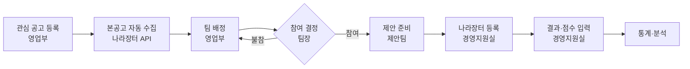

<div align="center">

# 수주로(路) · sujuro

**공고에서 수주까지, 입찰 업무의 길**

나라장터 입찰 업무를 한곳에서 관리하는 사내 SI 기업용 웹 서비스


</div>

---

## 프로젝트 소개

**수주로**는 공공 SI 기업이 나라장터 입찰 사업을 수주하기까지의 전 과정을 하나의 흐름으로 관리하는 서비스입니다.

공공 입찰은 공고를 찾는 일에서 끝나지 않습니다. 영업부가 사업을 발굴하고, 개발팀이 참여 여부를 판단하고, 제안팀이 제안서를 만들고, 경영지원실이 나라장터에 제출한 뒤, 결과를 분석해 다음 입찰에 반영하는 일까지 여러 부서가 이어서 움직입니다.
이 과정이 사람마다, 부서마다 흩어져 있으면 마감을 놓치거나, 누가 어디까지 했는지 알기 어렵고, 지난 입찰에서 배운 점이 쌓이지 않습니다.

수주로는 이 모든 업무를 **사업건 하나를 중심으로** 묶습니다. 한 건의 공고가 등록되는 순간부터 수주 또는 탈락 결과와 그 원인이 기록되기까지, 누구나 같은 화면에서 현재 상태를 확인할 수 있습니다.

### 해결하려는 문제

| 이전 | 수주로에서는 |
| --- | --- |
| 공고를 사람이 직접 찾고, 변경 공고를 놓치기 쉽다 | 나라장터 OpenAPI로 본공고와 변경 공고를 자동 수집한다 |
| 어느 팀이 참여하는지 메신저와 구두로 오간다 | 영업부 배정 → 팀장 참여/불참 결정이 시스템에 기록된다 |
| 제안서 목차와 요구사항 대응이 사람마다 다르다 | 주관팀이 저장한 목차 양식과 요구사항–목차 매핑으로 누락을 막는다 |
| 제출서류와 마감 일정을 따로 챙긴다 | 체크리스트, 팀 캘린더, 알림으로 한 번에 관리한다 |
| 결과가 나오면 경험이 흩어진다 | 점수, 강점, 감점 원인, 차기 보완점을 사업건에 남긴다 |

### 누가 쓰나요

| 사용자 | 하는 일 |
| --- | --- |
| 영업부 | 관심 공고 등록, 팀 배정과 재배정 |
| 팀장 | 참여/불참 결정, 제안팀 구성, 목차 담당자 지정(주관팀 팀장), 진행 현황 확인 |
| 팀원 | 제안서 목차 작성, 요구사항–목차 매핑, 제안서 파일 업로드 |
| 경영지원실 | 제출서류 확인, 나라장터 등록, 결과·점수 입력 |

사업건마다 **제안팀**이 있습니다. 사업을 개발하는 **주관팀**(사업건마다 하나)과, 제안서 작성을 함께하는 **참여팀**(여러 개 가능)의 인원으로 구성되며, 목차·요구사항·제안서 파일은 그 사업건의 제안팀만 볼 수 있습니다.

## 업무 흐름



## 주요 기능

**1. 공고 관리**
영업부가 입찰공고번호나 사전규격등록번호로 관심 공고를 등록하면 나라장터 OpenAPI로 본공고와 변경 공고를 가져와 연결합니다. 공고는 사전규격부터 결과까지 5단계로 관리하며, 공고문과 RFP 파일도 내려받을 수 있습니다.

**2. 배정과 참여 결정**
영업부가 팀을 배정하면 팀장이 참여 또는 불참을 결정합니다. 불참하면 재배정되고, 중도 철회까지 모두 이력으로 남습니다.

**3. 제안 준비 (목차·요구사항)**
- 주관팀이 저장해 둔 **목차 양식**을 불러오거나 직접 목차를 만듭니다. 양식 불러오기·저장은 주관팀 인원만 할 수 있습니다.
- 목차는 **단계 제한이 없고**, 번호는 "1.2.3 보안 방안"처럼 직접 입력합니다. 제안팀 누구나 목차를 추가·수정·삭제할 수 있습니다.
- 담당자·예상 쪽수·요구사항은 **가장 하위 목차**에만 둡니다. 담당자는 주관팀 팀장이 지정합니다.
- RFP 요구사항은 하나의 최하위 목차에만 연결되며(비기능 요구사항 포함), 연결되지 않은 요구사항은 "미매핑"으로 표시됩니다. 요구사항 관리는 주관팀 팀장과 목차 담당자가 합니다.
- 제안서와 제안요약서(발표본) 목차를 따로 구성하고, 목차별 예상 쪽수 합계를 페이지 제한과 비교합니다.

**4. 제출 준비**
제안서 파일을 목차별·버전별로 관리하고, 제출서류 체크리스트와 조견표로 빠진 서류를 막고, 예상 질문과 발표 Q&A를 미리 정리합니다.

**5. 결과 기록**
평가 항목별 점수와 수주/탈락 결과를 입력하고, 강점과 감점 원인, 다음에 보완할 점을 사업건에 함께 남깁니다.

**6. 알림과 일정**
배정·결정·담당 지정 같은 주요 시점과 마감 임박(D-3·D-1)을 화면 알림으로 알리고, 접속 중인 사용자에게는 웹소켓으로 바로 표시합니다. D-1에는 메일도 보냅니다. 팀별 월 캘린더에 공고 일정이 자동으로 표시되고 내부 일정도 등록할 수 있습니다.

**7. 대시보드와 통계**
역할별 할 일과 팀별 현황을 대시보드에서 확인하고, 연도·팀·사업 유형별 수주율과 평가 항목 분석을 차트로 보며 CSV로 내려받을 수 있습니다.

**8. 계정과 권한**
직원 등록 시 초기 비밀번호를 발급하고 첫 로그인 때 변경하도록 하며, 영업부·경영지원실·팀장·팀원 권한에 따라 볼 수 있는 화면과 기능을 나눕니다. 사업건 단위 화면은 서버에서 제안팀원인지 다시 확인하고(`AccessChecker`), 권한이 없으면 403으로 막습니다.

## 최근 업데이트

**2026.10.26 · 요구사항 v3.3 / ERD v3.2 반영**
- 외부 인력 계정을 없앴습니다. (관련 컬럼·공통코드·화면 코드 삭제)
- 제안팀을 **주관팀 / 참여팀**으로 나누고, 권한 판정을 `AccessChecker`로 모았습니다.
  - `requireProposalMember`: 제안팀(주관+참여) 전원 — 목차 추가·수정·삭제
  - `requireLeadTeamMember`: 주관팀 인원 — 목차 양식 불러오기·저장
  - `requireLeadTeamLeader`: 주관팀 팀장 — 목차 담당자 지정, 페이지 제한 (참여팀 팀장 제외)
- 목차: 기관 대표 양식 대신 **주관팀별 목차 양식**(`TB_TOC_FORM`), 단계 무제한, 번호 직접 입력, 담당자·요구사항은 최하위 목차만
- 제안서 / 제안요약서 목차 구분(`TOC_SE_CD`), 조견표 테이블(`TB_EVL_TOC_MPNG`) 추가
- 목차·요구사항 화면을 화면 설계 v3.2에 맞추고, 화면 파일을 뼈대·탭·조각으로 나눴습니다. (`templates/proposal`)
- 공고 단계를 5단계로 확장했습니다.
- 새 기능: 대시보드, 팀 캘린더, 통계(CSV), 마감 임박 알림(화면·메일), 실시간 알림(웹소켓)
- DB 스크립트가 바뀌었습니다. 아래 "시작하기"의 순서대로 다시 실행하세요.

**2026.10.22 ~ 10.23**
- 사용자 관리, 알림 화면(읽음 처리·종 배지), 사업건 접근 검사 추가
- 나라장터 API로 공고 불러오기, 사전규격등록번호로 공고 추가
- `bid` 패키지를 계층 구조(web·dto·mapper·service·service.impl·api)로 정리

**2026.10.18 ~ 10.20**
- 프로젝트 기반 구성(보안, 공통 레이아웃, 예외 처리), DB 로그인 연동, 초기 비밀번호 강제 변경
- DB 테이블·공통코드 스크립트, 제안팀 목차·요구사항 화면 첫 구현

## 기술 스택

| 구분 | 사용 기술 |
| --- | --- |
| Language | Java 11 |
| Framework | Spring Boot 2.7.18, Spring Security, Spring Validation, Spring Mail, Spring WebSocket |
| Persistence | MyBatis 2.3.2, Oracle 21c XE (ojdbc8), 공공데이터 공통표준용어 기반 테이블 23개 |
| View | Thymeleaf, Thymeleaf Layout Dialect, FullCalendar, Chart.js |
| 외부 API | 조달청 나라장터 OpenAPI (공공데이터포털) |
| Build · IDE | Maven, Spring Tools(STS) 4 |
| Collaboration | Git, GitHub (Pull Request 리뷰) |

## 프로젝트 구조

```
sujuro
├─ db
│  ├─ 01_schema.sql                  # 테이블 생성 (기존 테이블을 지우고 다시 만든다)
│  ├─ 02_code_data.sql               # 공통코드
│  ├─ 03_test_data.sql               # 팀·테스트 계정·테스트 공고 (개발용)
│  ├─ 03_sample_data.sql             # 목차 양식·샘플 사업건·요구사항 (개발용)
│  ├─ 05_test_notifications.sql      # 알림 화면 확인용 (선택)
│  └─ sujuro_테이블정의서_표준용어.xlsx
├─ src/main/java/com/ojj/sujuro
│  ├─ SujuroApplication.java         # 메인 클래스
│  ├─ auth · user                    # 로그인, 권한(AccessChecker), 계정
│  ├─ bid                            # 공고 (web · dto · mapper · service · api · code)
│  ├─ proposal                       # 제안 준비 (bid · toc · rqt)
│  ├─ result · history               # 입찰 결과·통계, 이력
│  ├─ schedule · notification        # 일정, 알림(웹소켓·메일)
│  ├─ dashboard                      # 대시보드
│  └─ common                         # 보안 설정, 예외 처리
├─ src/main/resources
│  ├─ application.properties         # 공통 설정 (Git 관리)
│  ├─ application-local.properties   # 개인 설정 (Git 제외)
│  ├─ mapper/                        # MyBatis SQL XML
│  ├─ templates/                     # Thymeleaf 화면 (화면이 크면 탭·fragments로 나눈다)
│  └─ static/                        # CSS · JS · 라이브러리
└─ src/test/java/com/ojj/sujuro      # 테스트
```

업무 패키지 안은 아래처럼 나눕니다.

| 폴더 | 넣는 것 |
| --- | --- |
| `web` | 화면 요청을 받는 컨트롤러 |
| `service` · `service.impl` | 업무 처리 (인터페이스 · 구현). 인터페이스 없이 클래스 하나면 `service`에 둡니다 |
| `mapper` | MyBatis 매퍼 인터페이스 (SQL은 `resources/mapper/<모듈>/`) |
| `dto` | 화면·DB 사이를 오가는 값 묶음 |
| `code` | 코드값·상수 (`Role`, `BidCode` 등) |
| `support` | 스케줄러·메일·웹소켓·인터셉터 같은 그 밖의 부품 |
| `api` | 바깥 시스템 호출 (나라장터) |

모듈 바로 아래에는 `package-info.java`만 둡니다.

## 시작하기

개발 환경은 각자 로컬 DB를 두는 방식입니다.

**준비물:** JDK 11, Spring Tools(STS) 4 + Lombok, Oracle 로컬 DB (Windows: Oracle 21c XE `XEPDB1` / macOS: Docker Oracle Free `FREEPDB1`)

```bash
git clone https://github.com/cjoh0407/sujuro.git
```

1. STS → File → Import → Existing Maven Projects → `sujuro` 선택. `pom.xml`이 바뀌면 프로젝트 우클릭 → Maven → Update Project(Alt+F5)를 합니다.
2. 본인 로컬 DB에 아래 순서로 실행합니다. `01`은 기존 테이블을 먼저 지우고 다시 만들기 때문에, 실행했다면 뒤 파일도 모두 다시 실행합니다.

   | 순서 | 파일 | 비고 |
   | --- | --- | --- |
   | 1 | `01_schema.sql` | 테이블 생성 |
   | 2 | `02_code_data.sql` | 공통코드 |
   | 3 | `03_test_data.sql` | 팀·테스트 계정·테스트 공고 |
   | 4 | `03_sample_data.sql` | 목차 양식·샘플 사업건 (3번이 먼저 있어야 함) |
   | 5 | `05_test_notifications.sql` | 선택 |

   > **DBeaver에서 실행할 때:** `SET DEFINE OFF`와 `/` 줄은 DBeaver가 다음 문장과 붙여 보내 ORA-00922 등의 오류가 납니다. 그 줄은 빼고 나머지를 선택해 Alt+X로 실행하세요. WHERE 없는 DELETE 경고는 확인을 누르면 됩니다.

3. `src/main/resources/application-local.properties`를 만들어 본인 값을 입력합니다. (Git에 올라가지 않는 파일입니다.)

   ```properties
   spring.datasource.url=jdbc:oracle:thin:@//localhost:1521/XEPDB1
   spring.datasource.username=본인_DB_계정
   spring.datasource.password=본인_DB_비밀번호
   spring.datasource.driver-class-name=oracle.jdbc.OracleDriver
   app.upload-dir=C:/dev/upload

   # 나라장터 OpenAPI 인증키 (공공데이터포털에서 받은 값 그대로). 없으면 서버가 시작되지 않습니다.
   g2b.service-key=인증키

   # (선택) 메일 알림. 없으면 화면 알림만 보냅니다.
   # spring.mail.host= / spring.mail.username= / spring.mail.password= / notice.mail.from=
   ```
   macOS는 서비스명을 `FREEPDB1`, 업로드 경로를 `/Users/이름/dev/upload` 형태로 바꿉니다.
   STS에서 이 파일의 한글이 깨져 보이면 파일 우클릭 → Open With → Text Editor로 여세요. (파일은 UTF-8)
4. `DbConnectionTest`를 JUnit으로 실행해 `DB 연결 성공` 로그를 확인합니다.
5. `SujuroApplication`을 Spring Boot App으로 실행하고 http://localhost:8080 에 접속합니다.

### 테스트 계정

비밀번호는 모두 `Demo!2026a`입니다. (`03_test_data.sql`)

| 사번 | 이름 | 소속 · 권한 | 비고 |
| --- | --- | --- | --- |
| 2024-0031 | 김가희 | 개발1팀 · 팀장 | 샘플 사업건 주관팀 팀장 (목차 양식·담당자 지정 가능) |
| 2024-0102 | 오창준 | 개발1팀 · 팀원 | 샘플 사업건 주관팀 팀원 |
| 2023-0067 | 박서연 | 영업부 | 공고 등록·배정 |
| 2022-0009 | 최민정 | 경영지원실 | 사용자 관리·제출·결과 |
| 2025-0001 | 이신입 | 개발1팀 · 팀원 | 초기 비밀번호 상태 (로그인하면 비밀번호 변경 화면) |

## 협업 규칙

- `main`에는 직접 push하지 않고, 각자 이름으로 딴 브랜치에서 Pull Request로 올립니다.
- PR은 팀원 1명 이상의 승인 후 합칩니다.
- 작업 전에 `git pull origin main --no-edit`으로 최신 main을 받아 합칩니다.
- 비밀번호와 API 키 같은 개인 값은 `application-local.properties`에만 둡니다.
- 기준 문서는 요구사항명세서 v3.3, ERD v3.2입니다.

## 팀 오종종

| 이름 | GitHub |
| --- | --- |
| 오창준 | [@cjoh0407](https://github.com/cjoh0407) |
| 김종민 | [@moongchimom](https://github.com/moongchimom) |
| 이세종 | [@sejong0705](https://github.com/sejong0705) |

> 개발 기간: 2026.10.12 ~ 2026.11.23
