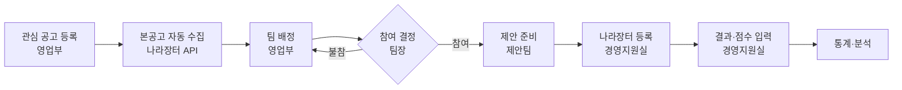

<div align="center">

# 수주로(路) · sujuro

**공고에서 수주까지, 입찰 업무의 길**

나라장터 입찰 업무를 한곳에서 관리하는 사내 SI 기업용 웹 서비스


</div>

---

## 프로젝트 소개

**수주로**는 공공 SI 기업이 나라장터 입찰 사업을 수주하기까지의 전 과정을 하나의 흐름으로 관리하는 서비스입니다.

공공 입찰은 공고를 찾는 일에서 끝나지 않습니다. 영업부가 사업을 발굴하고, 개발팀이 참여 여부를 판단하고, 제안팀이 제안서를 만들고, 경영지원실이 나라장터에 제출한 뒤, 결과를 분석해 다음 입찰에 반영하는 일까지 여러 부서가 이어서 움직입니다.
이 과정이 사람마다, 부서마다 흩어져 있으면 마감을 놓치거나, 누가 어디까지 했는지 알기 어렵고, 지난 입찰에서 배운 점이 쌓이지 않습니다.

수주로는 이 모든 업무를 **사업건 하나를 중심으로** 묶습니다. 한 건의 공고가 등록되는 순간부터 수주 또는 탈락 결과와 그 원인이 기록되기까지, 누구나 같은 화면에서 현재 상태를 확인할 수 있습니다.

### 해결하려는 문제

| 이전 | 수주로에서는 |
| --- | --- |
| 공고를 사람이 직접 찾고, 변경 공고를 놓치기 쉽다 | 나라장터 OpenAPI로 본공고와 변경 공고를 자동 수집한다 |
| 어느 팀이 참여하는지 메신저와 구두로 오간다 | 영업부 배정 → 팀장 참여/불참 결정이 시스템에 기록된다 |
| 제안서 목차와 요구사항 대응이 사람마다 다르다 | 공통 목차 양식과 요구사항–목차 매핑으로 누락을 막는다 |
| 제출서류와 마감 일정을 따로 챙긴다 | 체크리스트, 팀 캘린더, 알림으로 한 번에 관리한다 |
| 결과가 나오면 경험이 흩어진다 | 점수, 강점, 감점 원인, 차기 보완점을 사업건에 남긴다 |

### 누가 쓰나요

| 사용자 | 하는 일 |
| --- | --- |
| 영업부 | 관심 공고 등록, 팀 배정과 재배정 |
| 팀장 | 참여/불참 결정, 제안팀 구성, 진행 현황 확인 |
| 팀원 | 제안서 작성, 요구사항–목차 매핑, 제안서 파일 업로드 |
| 경영지원실 | 제출서류 확인, 나라장터 등록, 결과·점수 입력 |
| 외부 인력 | 제안에 함께하는 협력사 인력. 배정된 사업건만 볼 수 있는 제한 계정 |

## 업무 흐름



## 주요 기능

**1. 공고 관리**
영업부가 입찰공고번호로 관심 공고를 등록하면 나라장터 OpenAPI로 본공고와 변경 공고를 가져와 연결합니다. 공고문과 RFP 파일도 내려받을 수 있습니다.

**2. 배정과 참여 결정**
영업부가 팀을 배정하면 팀장이 참여 또는 불참을 결정합니다. 불참하면 재배정되고, 중도 철회까지 모두 이력으로 남습니다.

**3. 제안 준비**
제안팀을 구성하고 공통 목차 양식으로 제안서를 준비합니다. RFP 요구사항을 목차에 연결해 빠진 항목이 없는지 확인하고, 제안서 파일은 버전별로 관리합니다.

**4. 제출 준비**
제출서류 체크리스트와 조견표로 빠진 서류를 막고, 예상 질문과 발표 Q&A를 미리 정리합니다.

**5. 결과 기록**
평가 항목별 점수와 수주/탈락 결과를 입력하고, 강점과 감점 원인, 다음에 보완할 점을 사업건에 함께 남깁니다.

**6. 알림과 일정**
마감, 배정, 결정 등 주요 시점을 메일과 화면 알림으로 알리고, 팀 캘린더(FullCalendar)에 마감 일정을 자동으로 등록합니다.

**7. 통계**
수주율, 사업 유형별·기간별 현황을 차트(Chart.js)로 확인합니다.

**8. 계정과 권한**
직원 등록 시 초기 비밀번호를 발급하고 첫 로그인 때 변경하도록 하며, 영업부·경영지원실·팀장·팀원·외부 권한에 따라 볼 수 있는 화면과 기능을 나눕니다. 외부 인력은 팀장이 계정 발급을 요청하는 제한 계정입니다.

## 기술 스택

| 구분 | 사용 기술 |
| --- | --- |
| Language | Java 11 |
| Framework | Spring Boot 2.7.18, Spring Security, Spring Validation, Spring Mail |
| Persistence | MyBatis 2.3.2, Oracle 21c XE (ojdbc8), 공공데이터 공통표준용어 기반 테이블 21개 |
| View | Thymeleaf, Thymeleaf Layout Dialect, FullCalendar, Chart.js |
| Build · IDE | Maven, Spring Tools(STS) 4 |
| Collaboration | Git, GitHub (Pull Request 리뷰) |

## 프로젝트 구조

```
sujuro
├─ db
│  ├─ 01_schema.sql                  # 테이블 생성 (FK 순서대로 실행)
│  ├─ 02_code_data.sql               # 공통코드 초기 데이터
│  └─ sujuro_테이블정의서_표준용어.xlsx
├─ src/main/java/com/ojj/sujuro
│  ├─ SujuroApplication.java         # 메인 클래스
│  ├─ auth · user                    # 로그인, 권한, 계정
│  ├─ bid · proposal · result        # 공고, 제안 준비, 입찰 결과
│  ├─ schedule · notification        # 일정, 알림
│  ├─ dashboard                      # 대시보드
│  └─ common                         # 보안 설정, 예외 처리
├─ src/main/resources
│  ├─ application.properties         # 공통 설정 (Git 관리)
│  ├─ application-local.properties   # 개인 설정 (Git 제외)
│  ├─ mapper/                        # MyBatis SQL XML
│  ├─ templates/                     # Thymeleaf 화면
│  └─ static/                        # CSS · JS · 라이브러리
└─ src/test/java/com/ojj/sujuro      # 테스트
```

업무 패키지 안은 `web` · `service` · `service.impl` · `mapper`로 나눕니다.

## 시작하기

개발 환경은 각자 로컬 DB를 두는 방식입니다.

**준비물:** JDK 11, Spring Tools(STS) 4 + Lombok, Oracle 로컬 DB (Windows: Oracle 21c XE `XEPDB1` / macOS: Docker Oracle Free `FREEPDB1`)

```bash
git clone https://github.com/cjoh0407/sujuro.git
```

1. STS → File → Import → Existing Maven Projects → `sujuro` 선택
2. 본인 로컬 DB에 `db/01_schema.sql`, `db/02_code_data.sql` 순서로 실행합니다. (`01`은 기존 테이블을 먼저 지우고 다시 만듭니다.)
3. `src/main/resources/application-local.properties`를 만들어 본인 DB 정보를 입력합니다. (Git에 올라가지 않는 파일입니다.)

   ```properties
   spring.datasource.url=jdbc:oracle:thin:@//localhost:1521/XEPDB1
   spring.datasource.username=본인_DB_계정
   spring.datasource.password=본인_DB_비밀번호
   spring.datasource.driver-class-name=oracle.jdbc.OracleDriver
   app.upload-dir=C:/dev/upload
   ```
   macOS는 서비스명을 `FREEPDB1`, 업로드 경로를 `/Users/이름/dev/upload` 형태로 바꿉니다.
4. `DbConnectionTest`를 JUnit으로 실행해 `DB 연결 성공` 로그를 확인합니다.
5. `SujuroApplication`을 Spring Boot App으로 실행하고 http://localhost:8080 에 접속합니다.

## 협업 규칙

- `main`에는 직접 push하지 않고, 각자 이름으로 딴 브랜치에서 Pull Request로 올립니다.
- PR은 팀원 1명 이상의 승인 후 합칩니다.
- 비밀번호와 API 키 같은 개인 값은 `application-local.properties`에만 둡니다.

## 팀 오종종

| 이름 | GitHub |
| --- | --- |
| 오창준 | [@cjoh0407](https://github.com/cjoh0407) |
| 김종민 | [@moongchimom](https://github.com/moongchimom) |
| 이세종 | [@sejong0705](https://github.com/sejong0705) |

> 개발 기간: 2026.10.12 ~ 2026.11.23
